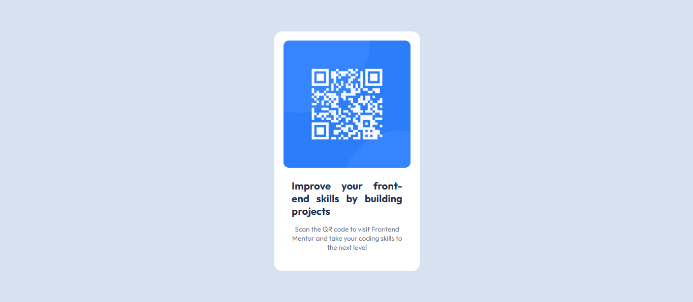

# Frontend Mentor - QR Code Component

Esta é a minha solução para o desafio QR code component, do Frontend Mentor. O objetivo é reproduzir o componente proposto utilizando stacks básicas de front end propostas pelo desafio.

## Índice

- Visão geral
  - Captura de tela
  - Links
- Processo de desenvolvimento
  - Tecnologias utilizadas
  - Aprendizados
  - Próximos passos
  - Recursos úteis
  - Uso de IA
- Autor

## Visão geral

O desafio consiste em construir um cartão com um QR Code e um texto de orientação, buscando se aproximar 
do layout de referência fornecido pelo Frontend Mentor.

### Captura de tela

### Links
- Repositório: [fm-qr-code-component](https://github.com/CamiloGCode/fm-qr-code-component)
- Site publicado: adicione aqui o link após publicar o projeto.
- Desafio: [QR code component — Frontend Mentor](https://www.frontendmentor.io/challenges/qr-code-component-iux_sIO_H)

## Processo de desenvolvimento

### Tecnologias utilizadas

- HTML5 semântico
- CSS3
- Flexbox para alinhamento e posicionamento dos elementos
- Fluxo de trabalho mobile-first e responsividade, conforme implementados no projeto

### Aprendizados

Neste desafio, pratiquei a estruturação de uma página com HTML e a estilização de um componente utilizando CSS. O projeto também serve como exercício para trabalhar alinhamento, espaçamento, tipografia e apresentação de imagens em uma interface simples.

### Próximos passos

- Comparar o resultado final com as referências para desktop e dispositivos móveis.
- Revisar a responsividade em diferentes larguras de tela.
- Publicar a página e adicionar o link de demonstração.
- Registrar uma captura de tela da solução final neste README.

### Recursos úteis

- Documentação do MDN sobre HTML — referência para a estrutura da página.
- Documentação do MDN sobre CSS — referência para a estilização.
- Frontend Mentor — plataforma do desafio e referência visual utilizada durante o desenvolvimento.

### Uso de IA

Utilizei o ChatGPT como apoio para organizar a documentação do projeto e estruturar este README de acordo com o modelo do Frontend Mentor. A implementação do código e a validação visual devem ser revisadas por mim para garantir que compreendo as decisões tomadas.

## Autor

- GitHub: [@CamiloGCode](https://github.com/CamiloGCode) 
- Frontend Mentor: [@CamiloGCode](https://www.frontendmentor.io/profile/CamiloGCode)
- Linkedin: www.linkedin.com/in/gabrielcamilodev
